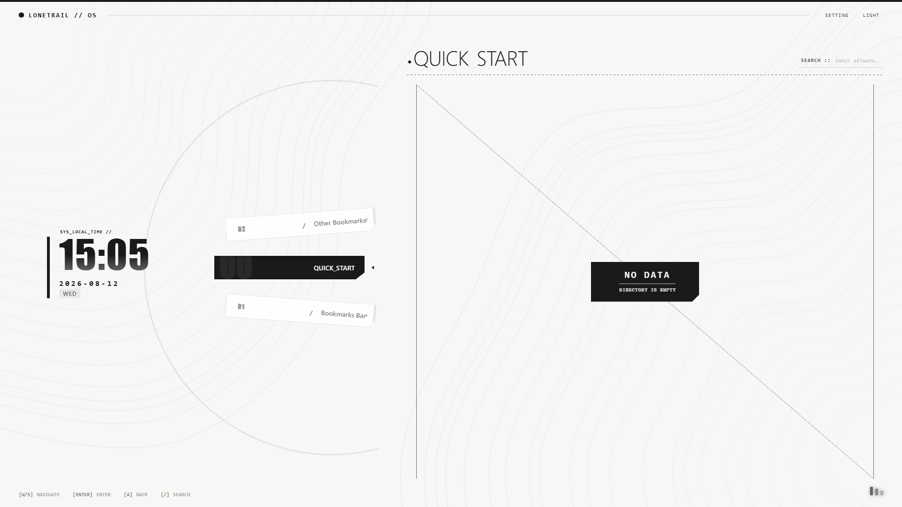

# LoneTrail-Tab

**LoneTrail-Tab** 是一个复古终端风格的浏览器新标签页扩展。
可以通过**键盘操作**快速检索收藏夹内容，并进行网页跳转

  

## ✨ 特性 (Features)

* **⌨️ 全键盘操控**: 使用的 WASD / 方向键导航逻辑，双手无需离开键盘（保留鼠标操作支持）。
* **🧬 随机背景生成**: 动态生成 SVG 等高线背景。
* **🌗 昼夜切换**: 内置 Light/Dark 双色主题，支持一键切换。
* **📂 层级导航**: 像在终端中浏览文件系统一样浏览你的书签文件夹（支持无限层级）。
* **🔍 模糊搜索**: 实时递归搜索所有书签，支持一键跳转。
* **⚡ 轻量级**: 基于原生 JavaScript (ES Modules) 构建，无任何第三方重型框架依赖。

## 🎬 界面演示 (Demo)
LoneTrail-Tab 提供了两种主题模式，还原复古终端的科技感体验：

### 🌑 暗色模式
经典的复古实验室终端风格，适配夜间使用场景：


### 🌕 亮色模式
更柔和的高对比度配色，适配日间使用场景：


## 🚀 安装指南 (Installation)

由于本项目目前处于开发阶段，请通过开发者模式安装：

1.  克隆或下载本项目到本地：
    ```bash
    git clone [https://github.com/JiangMingQin/LoneTrail-Tab.git](https://github.com/JiangMingQin/LoneTrail-Tab.git)
    ```
2.  打开 Chrome 浏览器，访问 `chrome://extensions/`。
3.  开启右上角的 **"开发者模式" (Developer mode)**。
4.  点击左上角的 **"加载已解压的扩展程序" (Load unpacked)**。
5.  选择本项目的根目录。
6.  打开新标签页 (Ctrl+T)，即可体验。

## 🎮 操作手册 (Controls)

| 按键 | 功能 |
| :--- | :--- |
| **W / S** (↑ / ↓) | 上下移动光标 |
| **A** (←) | 返回上一级 / 退出搜索 / 焦点回到左侧 |
| **D** (→) | 进入文件夹 / 焦点进入右侧 / 打开链接 |
| **Enter** | 打开选中的链接或文件夹 |
| **/** | 激活顶部搜索框 |
| **Esc** | 退出搜索 / 关闭设置弹窗 |

## 🛠️ 项目结构

本项目保持极简的扁平化结构，便于学习和二次开发：

* `js/main.js`: 核心入口与初始化
* `js/state.js`: 状态管理与配置持久化
* `js/events.js`: 键盘与鼠标事件监听
* `js/actions.js`: 业务逻辑与导航计算
* `js/render.js`: DOM 渲染引擎
* `js/background.js`: 动态 SVG 背景生成算法

详细的架构说明请参阅 [PROJECT_DOCS.md](PROJECT_DOCS.md)。
完整的版本变更记录请参阅 [CHANGELOG.md](CHANGELOG.md)。

## 🤝 贡献 (Contributing)

欢迎提交 Issue 或 Pull Request！
在提交代码前，请确保遵循项目现有的 Airbnb 代码规范

## 📄 协议 (License)

本项目基于 [MIT License](LICENSE) 开源。

---

*Design inspired by retro terminals and laboratory aesthetics.*


