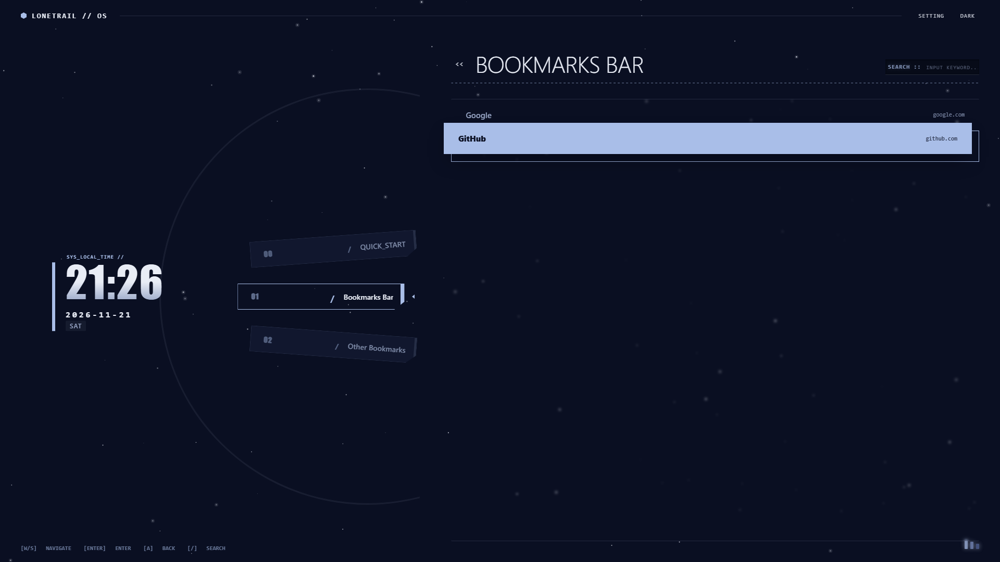

# CH3-Orange Tab

<p align="center">
  
</p>

  

CH3-Orange Tab（甲基橙） 是一个粗野主义科幻终端风格的浏览器新标签页扩展。可以完全通过键盘操作快速检索收藏夹内容，并进行网页跳转。

## ✨ 特性 (Features)

| 功能 | 说明 |
|:---|:---|
| **📂 层级浏览书签** | 使用的 WASD / 方向键导航逻辑，双手无需离开键盘（保留鼠标操作支持） |
| **⚡ 智能快捷栏** | 自动把最常用的书签排在最前，越常用的越顺手 |
| **🔍 实时搜索** | 按 `/` 直接搜，实时递归搜索所有书签，支持一键跳转 |
| **🌗 双主题** | 暗色星空 / 亮色等高线，按 `T` 一键切换 |
| **⚡ 轻量级** | 基于原生 JavaScript (ES Modules) 构建，无任何第三方重型框架依赖 |


## 🎬 界面演示 (Demo)

以下截图均为 **3D 透视模式**（设置中开启 `PERSPECTIVE`），界面数据为 Lorem 占位演示数据。

### 🌑 暗色主题（Dark Theme）

随机星空背景，适配夜间使用场景：



### 🌕 亮色主题（Light Theme）

随机等高线地形图背景，适配日间使用场景：


## 🚀 安装指南 (Installation)

Chrome / Edge 等 Chromium 浏览器，任选一种方式获取扩展：

**方式一：下载 Release 包（推荐）**

前往 [Releases 页面](https://github.com/JiangMingQin/CH3-Orange-Tab/releases) 下载
[`CH3-Orange-Tab-v1.2.0.zip`](https://github.com/JiangMingQin/CH3-Orange-Tab/releases/download/v1.2.0/CH3-Orange-Tab-v1.2.0.zip)，
解压出 `CH3-Orange-Tab` 文件夹。

**方式二：克隆仓库（适合开发 / 贡献）**

```bash
git clone https://github.com/JiangMingQin/CH3-Orange-Tab.git
```

获取到 `CH3-Orange-Tab` 文件夹后：

1. 打开 `chrome://extensions/`（Edge 为 `edge://extensions/`），开启右上角「开发者模式」
2. 点击「加载已解压的扩展程序」，选中 `CH3-Orange-Tab` 文件夹

打开新标签页（`Ctrl+T`）即可使用。没有书签权限时会自动加载演示数据。

## 🎮 操作手册 (Controls)

| 按键 | 功能 |
|:---|:---|
| `W` `S` / `↑` `↓` | 上下移动 |
| `A` / `←` | 返回上一级 / 退出搜索 |
| `D` / `→` | 进入文件夹 / 打开链接 |
| `Enter` | 打开选中项 |
| `Backspace` | 返回上一级 |
| `/` | 激活搜索 |
| `Esc` | 退出搜索 / 关闭设置 |
| `T` | 切换明暗主题 |
| `O` | 打开设置 |

按 `O` 或点击右上角 `SETTING` 按钮打开设置弹窗，可调整主题、时钟显示、快捷栏数量（3–12 条）、按键映射等；界面会自动尊重系统「减弱动态效果」偏好（`prefers-reduced-motion`）。

## 🛠️ 项目结构 (Structure)

扩展本体位于 `CH3-Orange-Tab/`，无构建步骤、无第三方运行时依赖：

```text
CH3-Orange-Tab/
├── manifest.json          # 扩展清单（Manifest V3），注册 newtab 与 16/32/48/128 图标
├── newtab.html            # 新标签页入口：静态骨架 + data-i18n 绑定
├── icons/                 # icon.svg 源文件 + 导出的 16/32/48/128 PNG
├── css/
│   ├── main.css           # 样式入口，按序 @import 下列文件
│   ├── variables.css      # 主题变量：亮色「米色塑料磁带机」/ 暗色「星空之夜」
│   ├── base.css           # Reset 与基础样式
│   ├── layout.css         # 顶栏、主容器与品牌位
│   ├── dial.css           # 左侧圆形拨盘（环形定位、选中扫描、图标反色）
│   ├── list.css           # 右侧列表、浮层卡与空状态
│   └── modules/           # 独立组件样式
│       ├── search.css     # 取景框式搜索栏
│       ├── modal.css      # 设置弹窗
│       ├── toast.css      # 操作反馈横条
│       └── clock.css      # 时钟 HUD
└── js/                    # 逻辑层（原生 ES Modules，无构建）
    ├── main.js            # 入口：加载配置、初始化模块、书签数据（无扩展 API 时用 Lorem 演示数据）
    ├── state.js           # 集中状态、localStorage 持久化与旧存储键迁移
    ├── render.js          # 增量渲染：拨盘、列表、浮层卡、倾斜平面
    ├── events.js          # 键盘 / 鼠标 / 设置弹窗事件
    ├── actions.js         # 动作分发（命令模式）
    ├── background.js      # 背景生成：亮色等高线 / 暗色星场
    ├── clock.js           # 时钟 HUD
    ├── i18n.js            # 文案字典：t() 主界面固定英文，tSettings() 随语言切换
    ├── icons.js           # 内联 Phosphor regular SVG（search / folder / x）
    ├── utils.js           # 工具：XSS 转义、防抖、主题与透视应用
    └── features/          # 功能模块
        ├── navigation.js  # WASD / 方向键层级导航
        ├── search.js      # 书签递归搜索
        ├── algorithm.js   # Frecency：频率 × 时间衰减的快捷栏排序
        └── toast.js       # 操作反馈横条的显示与闪烁
```

仓库根目录另存放 README、CHANGELOG、PROJECT_DOCS、LICENSE，以及 `assets/`（README 用的界面截图）。

详细架构说明见 [PROJECT_DOCS.md](PROJECT_DOCS.md)。

## 🤝 贡献 (Contributing)

欢迎提交 Issue 或 Pull Request！提交前请遵循项目现有的代码风格：ES Modules 模块化结构、集中状态管理、增量渲染与清晰的命名约定。

## 📄 协议 (License)

本项目基于 [MIT License](LICENSE) 开源。

---

*设计灵感源自《明日方舟》、《尼尔机械纪元》，粗野主义*
